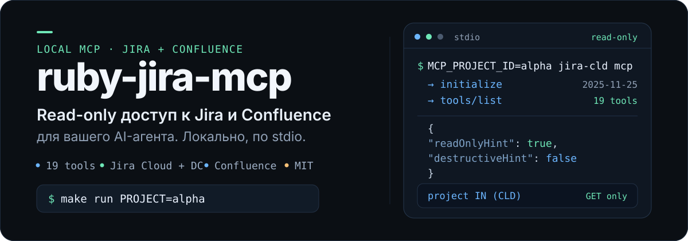
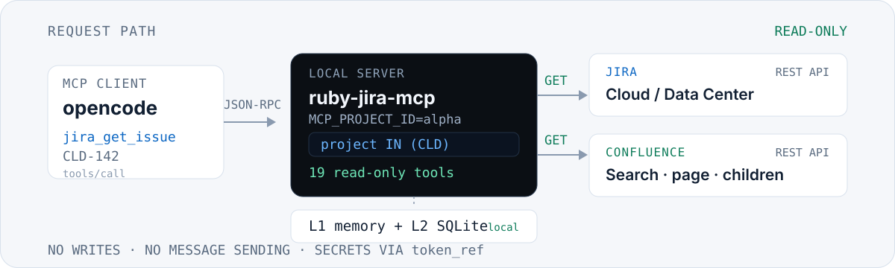

<p align="center">
  
</p>

<h1 align="center">ruby-jira-mcp</h1>

<p align="center">
  <strong>Read-only Jira и Confluence для AI-агента.</strong><br>
  Локальный MCP-сервер: stdio или Streamable HTTP. Токен остаётся в сервере, клиент подключается по URL.
</p>

## Подключить за 3 минуты

```bash
make env          # создаст .env из .env.example
vi .env           # JIRA_API_TOKEN + JIRA_EMAIL (Cloud) или JIRA_PAT (DC)
make install
make setup PROJECT=alpha
make doctor PROJECT=alpha
```

`make` сам копирует `.env.example` в `.env` и подхватывает значения. Для Jira Cloud
нужны `JIRA_EMAIL` + `JIRA_API_TOKEN`; для Data Center — `JIRA_PAT`.

### Вариант A: Docker + URL (рекомендуется)

Контейнер держит токен и конфиг у себя, клиент подключается только по URL:

```bash
make docker-up PROJECT=alpha HTTP_PORT=8765
```

Контейнер работает в фоне. Статус и логи: `make docker-status PROJECT=alpha`,
`make docker-logs PROJECT=alpha`; остановка: `make docker-down PROJECT=alpha`.

В `opencode.json` — без токена и без команды:

```json
{
  "mcp": {
    "servers": {
      "jira-alpha": {
        "type": "remote",
        "url": "http://127.0.0.1:8765/mcp",
        "enabled": true
      }
    }
  }
}
```

Порт публикуется только на `127.0.0.1`. Токен передаётся контейнеру из `.env`.

### Вариант B: локальный процесс (stdio)

```json
{
  "mcp": {
    "servers": {
      "jira-alpha": {
        "type": "local",
        "command": ["bundle", "exec", "bin/jira-cld", "mcp"],
        "cwd": "/absolute/path/to/ruby-jira-mcp/src",
        "pool": false,
        "environment": {
          "MCP_PROJECT_ID": "alpha",
          "JIRA_API_TOKEN": "{env:JIRA_API_TOKEN}"
        }
      }
    }
  }
}
```

Проверка: `opencode mcp list` → `connected`.
Подробнее: [OPENCODE.md](docs/usage/OPENCODE.md).

## Что даёт

| Область | Возможности |
|---|---|
| **Jira** | JQL-поиск, задачи, comments/changelog, вложения (метаданные), boards и sprints |
| **Confluence** | CQL-поиск, страница по id/title, дочерние страницы, текст без макросов |
| **Команда** | `team_who_knows`, `team_prepare_question`: evidence и готовые вопросы, без отправки |
| **Каталог** | `project_list`, `project_describe`, `project_resolve` |

Всего 19 tools. Полный справочник аргументов и ответов: [TOOLS.md](docs/usage/TOOLS.md).

## Как это работает

<p align="center">
  
</p>

- MCP-клиент общается с `jira-cld` по stdio или Streamable HTTP (`/mcp`).
- В stdio stdout — только JSON-RPC, логи — stderr. В HTTP логи идут в stderr.
- Сервер делает только `GET`-запросы к Jira и Confluence.
- JQL оборачивается в `project IN (<allowlist>)`, CQL — в `space IN (<allowlist>)`.
- Ответы кэшируются локально: L1 в памяти, L2 SQLite. Кэш не покидает машину.
- Один процесс — один проект. Это изолирует данные и `cache.db`.

## Безопасность

> **Read-only by design.** Нет записи в Jira/Confluence, отправки сообщений и multi-user режима.

- Секреты хранятся только в env или `token_ref` (`env:`, `file:`, `command:`, `keyring:`).
- MCP HTTP слушает loopback и не имеет встроенной аутентификации: не публикуйте порт наружу.
- `project`, `space`, `ORDER BY` и `;` в пользовательских JQL/CQL отклоняются.
- Секреты не попадают в логи, HTML и `export diagnostics`.
- UI слушает только `127.0.0.1`, использует одноразовый токен, CSRF и CSP.

## Команды

```bash
make run PROJECT=alpha        # stdio MCP (обычно запускает клиент)
make mcp-http PROJECT=alpha   # HTTP MCP на 127.0.0.1:8765/mcp
make print-opencode PROJECT=alpha   # готовый JSON для opencode (URL, без токена)
make docker-up PROJECT=alpha        # собрать и запустить HTTP MCP в фоне
make docker-status PROJECT=alpha    # статус контейнера + health
make docker-logs PROJECT=alpha      # логи контейнера
make docker-down PROJECT=alpha      # остановить и удалить контейнер
make docker-up-ui                   # UI в Docker в фоне (порт 9292)
make docker-down-ui                 # остановить UI
make doctor PROJECT=alpha     # конфиг, секреты, сеть, SQLite
make stats PROJECT=alpha      # статистика вызовов
make cache-stats PROJECT=alpha
make cache-clear PROJECT=alpha YES=1 SCOPE=expired
make ui                       # локальный UI
make check                    # тесты + rubocop + assets
```

`make doctor PROJECT=alpha OFFLINE=1` проверяет всё без сети.

## Настройка

Конфиг: `~/.config/jira-cld/config.yml` (или `CONFIG_PATH`). Секретов в нём нет —
только ссылки вида `token_ref: env:JIRA_API_TOKEN`.

```bash
make setup PROJECT=alpha JIRA_URL=https://acme.atlassian.net \
  EMAIL=dev@acme.io JIRA_KEY=CLD SPACE=CLD
```

Данные:

```text
~/.local/share/jira-cld/
├── global/reference.db
├── stats.db
├── <project>/cache.db
└── .trash/<id>-<UTC>/
```

Готовые примеры: [cloud](docs/agent-config-examples/jira-cld.cloud.yml),
[Data Center](docs/agent-config-examples/jira-cld.dc.yml),
[minimal](docs/agent-config-examples/jira-cld.minimal.yml).

## Docker и Nix

<details>
<summary>Docker: headless и full</summary>

```bash
make docker-headless
docker run --rm \
  -p 127.0.0.1:8765:8765 \
  -v "$PWD/config.yml:/home/jira/.config/jira-cld/config.yml:ro" \
  -v "$PWD/data:/home/jira/.local/share/jira-cld" \
  -e MCP_PROJECT_ID=alpha \
  -e JIRA_API_TOKEN \
  jira-cld:local-headless mcp-http
```

`make docker-up` делает это автоматически в фоне, берёт секреты из `.env` и ждёт
`/health`. `make docker-run-http` — тот же запуск на переднем плане для отладки.
Для stdio передайте `mcp` вместо `mcp-http` и используйте `-i` без `-p`.

```bash
make docker-up-ui                 # в фоне, печатает URL с токеном
make docker-logs-ui               # URL также виден в логах
make docker-down-ui
```

Ручной запуск UI:

```bash
make docker-full
docker run --rm -p 127.0.0.1:9292:9292 \
  -e UI_HOST=0.0.0.0 -e UI_PORT=9292 -e UI_OPEN=0 \
  -v "$PWD/config-dir:/home/jira/.config/jira-cld" \
  -v "$PWD/data:/home/jira/.local/share/jira-cld" \
  jira-cld:local-full ui
```

Образы non-root (`uid 10001`). Docker-таргеты запускают контейнер от текущего
uid/gid, чтобы каталог данных на хосте оставался доступен на запись.

</details>

<details>
<summary>Nix</summary>

```bash
nix develop
make install
make run PROJECT=alpha
```

</details>

## Ограничения v1

- Нет OAuth, multi-user, Postgres/Redis. HTTP-транспорт MCP — только loopback, без встроенной аутентификации.
- Вложения — только метаданные и URL, без скачивания.
- Нет полнотекстового поиска по KB и durable-зеркала страниц (v1.1).
- `team_*` готовят вопросы, но ничего не отправляют.

## Документация

- [Полное руководство](docs/GUIDE.md)
- [Быстрый старт](docs/usage/GENERAL.md)
- [Headless/CLI](docs/usage/NO-UI.md)
- [Локальный UI](docs/usage/UI.md)
- [Tools и prompts](docs/usage/TOOLS.md)
- [Подключение к opencode](docs/usage/OPENCODE.md)
- [Примеры конфигов](docs/agent-config-examples/)
- [Спецификация](docs/SRD.md)

## Разработка

```bash
make test
make lint
make check
```

Требования: Ruby 4.0+, Bundler 4.0+, Linux/macOS. Лицензия: [MIT](LICENSE).
